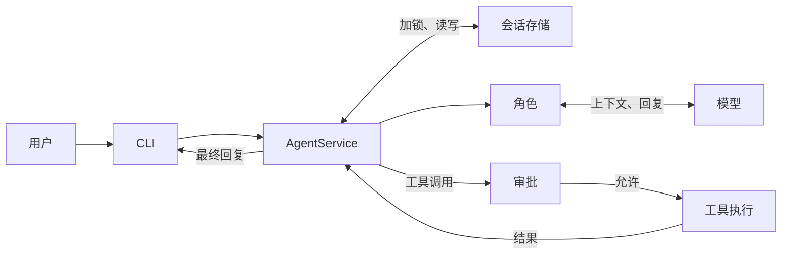

# 项目架构

- `domain`：消息、会话、上下文和工具定义。
- `application`：角色通过 `Role` 提供模型请求和工具；`Assistant` 管理自己的提示词和工具定义，`AgentService` 编排对话、审批和会话保存。
- `adapter`：CLI、OpenAI 兼容客户端、JSONL 会话存储和 Bash 工具。
- `main.rs`：读取配置并组装依赖。

## 对话数据流

工具结果保存后交回模型，直到得到最终回复或达到迭代上限。中断后，结果未知的工具调用不会自动重放。