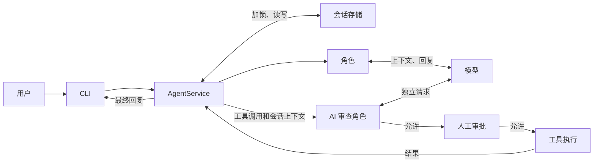

# 项目架构

- `domain`：消息、会话、上下文和工具定义。
  计划由有序阶段和阶段内有序任务组成；阶段与任务的编号按顺序生成。
- `application`：`Assistant` 生成回复；`Planner` 将目标与历史转换为有序计划，不执行工具；`ToolCallReviewer` 审查工具调用；`AgentService` 编排对话和会话保存。
- `adapter`：CLI、OpenAI 兼容客户端、JSONL 会话存储和 Bash 工具。
- `main.rs`：读取配置并组装依赖。

## 对话数据流

AI 审查拒绝、失败或返回格式无效时不会执行工具；通过后仍需人工批准。工具结果保存后交回模型，直到得到最终回复或达到迭代上限。中断后，结果未知的工具调用不会自动重放。

`Planner::plan` 返回结构化 `Plan`；作为 `Role` 使用时返回编号文本。当前入口默认使用 `Assistant`。